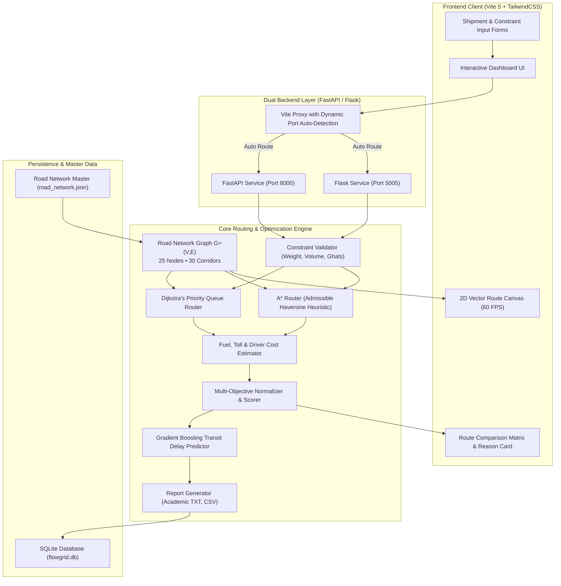

# AI-Powered Smart Trade Route Optimization System
### HETVAYA FlowGrid • Intelligent Multi-Objective Logistics & Freight Decision Platform

[](https://www.python.org/)
[](https://fastapi.tiangolo.com/)
[](https://flask.palletsprojects.com/)
[](https://vitejs.dev/)
[](https://tailwindcss.com/)
[-brightgreen?style=flat&logo=pytest&logoColor=white)](tests/)

---

## 1. Project Identity & Academic Context

* **Project Title**: AI-Powered Smart Trade Route Optimization System
* **Academic Level**: Third Year B.Tech AIML, Semester V (Academic Year 2026–27)
* **Institution**: **D. Y. Patil Agriculture & Technical University, Talsande**
* **Department**: Department of Computer Science & Engineering (AIML)
* **Project Guide**: **Mr. R. S. Todkar**

### Student Development Team

| Name | PRN | Role |
| :--- | :--- | :--- |
| **Atharv Chandrakant Jadhav** | `2025011042044` | Full-Stack Architecture, Algorithm Design |
| **Harshwardhan Yashwantrao Mohite** | `2025011042014` | Routing Engine & Graph Modeling |
| **Suraj Sunil Shewale** | `2025011042033` | ML Predictive Analytics & Cost Models |
| **Rajvardhan Sambhaji Jadhav** | `2025011042013` | Database Schema & API Integrations |
| **Abubakharsiddik Shakil Tanekhan** | `2024011041126` | Vector Canvas Visualization & UI |
| **Mansi Suresh Chougule** | `2025011042033` | Validation, Test Suite & Documentation |

---

## 2. Executive Overview

Conventional commercial route-planning applications typically prioritize single objectives (such as purely shortest distance or shortest travel time) without accounting for real-world freight constraints: vehicle axle-weight limitations, cargo cubic volume, steep Western Ghat passes, fuel burn under heavy loads, toll tariffs, driver shift wages, and customer delivery deadlines.

The **AI-Powered Smart Trade Route Optimization System** is a high-performance web-based decision-support platform designed for trade planners, freight operators, and supply chain managers. It models trade networks as weighted directed graphs $G = (V, E)$, computes optimal least-cost paths using **Dijkstra's** and **A\*** search algorithms, generates distinct alternative corridors, scores candidates using a normalized **Multi-Objective Optimization Function**, and categorizes transit delay risks using **Gradient Boosting Machine Learning models**.

All transit time, fuel expenditure, and risk projections are treated as **planning estimates** with fully transparent fallback assumptions when live GPS telemetry is offline.

---

## 3. System Architecture



---

## 4. The 11 Core System Modules

### Module 1: User Input & Constraint Validation
* Collects and sanitizes: Origin hub, Destination terminal, Payload weight (kg/tons), Cargo volume (m³), Designated vehicle category, Delivery deadline (hours), and 4 priority weights.
* Rejects zero/negative cargo quantities, identical origins/destinations, or unmapped nodes with clear, descriptive error messages.

### Module 2: Road Network Weighted Graph
* Weighted graph representation $G = (V, E)$ loaded from `src/data/road_network.json`.
* Covers **25 primary trade hubs** across Maharashtra and Western India (JNPT, Bhiwandi, Mumbai Central, Panvel, Pune, Chakan, Satara, Kolhapur, Kasara, Nashik, Aurangabad, Belagavi, Goa, Surat, etc.).
* Encompasses **30 bidirectional corridors** annotated with road distance, expected speeds, tolls, corridor risk indices, weight restrictions, and Western Ghats flags.

### Module 3: Dual Route Search Engine
* **Dijkstra's Algorithm**: Utilizes a binary min-heap (`heapq`) to explore least-cost paths with non-negative edge weights across distance, transit time, financial cost, and corridor safety.
* **A\* Search Algorithm**: Accelerates pathfinding toward the destination using an **admissible Haversine great-circle distance heuristic** $h(n) \le h^*(n)$, guaranteeing mathematically optimal paths while expanding fewer search states.
* **Route Constraint Validator**: Prunes road segments exceeding the vehicle's axle-weight limit or violating ghat travel restrictions.

### Module 4: Alternative Route Generation
* Automatically synthesizes multiple distinct candidate alternatives:
  1. **Fastest Transit Corridor** (A* optimized for travel time)
  2. **Shortest Direct Distance Route** (Dijkstra optimized for minimal km)
  3. **Lowest Freight & Toll Cost Route** (Optimized for minimal fuel and toll expenses)
  4. **Lowest Risk Bypass Corridor** (Safest route avoiding ghats and high-congestion bottlenecks)
* Detour deduplication ensures only unique paths are returned.

### Module 5: Cost Estimation Engine
Calculates total transportation expenses based on configurable vehicle parameters:
$$\text{Adjusted Mileage} = \text{Base Mileage} \times \left(1.0 - 0.15 \times \frac{\text{Payload Weight}}{\text{Max Capacity}}\right) \times \text{Ghat Multiplier}$$
$$\text{Fuel Consumed (L)} = \frac{\text{Distance (km)}}{\text{Adjusted Mileage}}$$
$$\text{Total Cost (INR)} = \text{Fuel Cost} + \text{Toll Charges} + \text{Driver Wages} + \text{Vehicle Maintenance}$$

### Module 6: Travel Time Estimation
$$\text{Travel Time} = \sum \left(\frac{\text{Segment Distance}}{\text{Expected Speed}}\right) + \text{Traffic Delay Multiplier}$$
* Automatically introduces terrain and weather buffers for steep ghat corridors (Khandala Ghat, Kasara Ghat, Amboli Ghat).
* Transparently displays baseline fallback assumptions when live GPS telemetry is unavailable.

### Module 7: Multi-Objective Optimization Engine
Applies Min-Max normalization to map distance, transit time, freight cost, and risk into a standard $[0.0, 1.0]$ space:
$$\text{Score} = (W_{\text{time}} \times T_{\text{norm}}) + (W_{\text{cost}} \times C_{\text{norm}}) + (W_{\text{dist}} \times D_{\text{norm}}) + (W_{\text{risk}} \times R_{\text{norm}})$$
$$\text{Constraint: } W_{\text{time}} + W_{\text{cost}} + W_{\text{dist}} + W_{\text{risk}} = 1.0$$
The candidate with the lowest multi-objective score is selected as the **Recommended Route**, accompanied by natural language rationale explaining why it was chosen.

### Module 8: Predictive Analytics (Machine Learning)
* Employs scikit-learn **Gradient Boosting Regressor** trained on historical freight trip observations to estimate transit delay in minutes.
* Predicts delay risk classification (`LOW`, `MEDIUM`, `HIGH`) and load-dependent fuel burn multipliers.

### Module 9: Route Comparison & Vector Map Canvas
* Interactive, hardware-accelerated 2D Vector Canvas rendering map geometries at 60 FPS without external Mapbox or Google Maps token dependencies.
* Color-coded paths: Recommended Route (glowing Indigo), Alternative Routes (dashed Emerald, Amber, Violet), Origin/Destination markers, and Western Ghats hazard polygons.

### Module 10: Database Management
* SQLAlchemy ORM entities:
  * `ShipmentPlanRequest`: Stores mission parameters, deadlines, and user-configured weights.
  * `TradeRouteResult`: Stores candidate routes, waypoints, toll breakdowns, and multi-objective scores.
* Persisted in SQLite (`src/data/flowgrid.db`) with full historical audit and recall endpoints.

### Module 11: Report Generation Engine
* **Academic Text Summary**: Generates comprehensive printable reports citing institutional credentials, project guide Mr. R. S. Todkar, student authors, route breakdown, and corridor warnings.
* **Comparison Matrix (CSV)**: Generates tabular comma-separated values ready for spreadsheet analysis.

---

## 5. Mathematical Formulations

### Dijkstra's Algorithm
$$\text{Initialize: } d(s) = 0, \quad d(v) = \infty \quad \forall v \ne s$$
$$\text{Relaxation: If } d(u) + w(u, v) < d(v) \implies d(v) = d(u) + w(u, v), \quad \pi(v) = u$$

### A* Search Algorithm
$$f(n) = g(n) + h(n)$$
* $g(n)$: Exact accumulated cost from start node to node $n$.
* $h(n)$: Admissible Haversine great-circle distance heuristic:
$$h(n) = 2 R \arcsin\left(\sqrt{\sin^2\left(\frac{\Delta \phi}{2}\right) + \cos(\phi_1)\cos(\phi_2)\sin^2\left(\frac{\Delta \lambda}{2}\right)}\right)$$
Because the great-circle distance is strictly $\le$ actual road distance, $h(n)$ is admissible ($h(n) \le h^*(n)$), ensuring optimal shortest path convergence.

---

## 6. Vehicle Catalog & Fleet Specifications

| Vehicle Code | Commercial Name | Category | Max Payload | Max Volume | Base Mileage | Driver Rate |
| :--- | :--- | :---: | :---: | :---: | :---: | :---: |
| `LCV_TATA_ACE` | Tata Ace Gold | LCV | 1.5 Tons | 8.5 m³ | 14.5 km/l | ₹180 / hr |
| `MCV_EICHER_14T` | Eicher Pro 2049 | MCV | 5.0 Tons | 24.0 m³ | 7.8 km/l | ₹320 / hr |
| `HCV_BHARATBENZ_16T` | BharatBenz 1617R | HCV | 16.0 Tons | 45.0 m³ | 4.5 km/l | ₹480 / hr |
| `TRAILER_40FT` | Tata Signa 4018.S | Trailer | 32.0 Tons | 80.0 m³ | 3.2 km/l | ₹650 / hr |
| `EV_CARGO_VAN` | Tata Ace EV | Electric | 1.0 Tons | 6.0 m³ | 0.22 kWh/km | ₹160 / hr |

---

## 7. REST API Reference

The system provides fully compliant REST endpoints on both **FastAPI** (`http://127.0.0.1:8000`) and **Flask** (`http://127.0.0.1:5005`):

| Endpoint | Method | Description |
| :--- | :---: | :--- |
| `/api/v1/trade-routes/optimize` | `POST` | Executes multi-objective routing (Dijkstra + A*) and returns ranked routes with ML delay predictions. |
| `/api/v1/trade-routes/network-nodes` | `GET` | Returns all 25 graph junctions and 30 road corridors for canvas plotting. |
| `/api/v1/trade-routes/vehicles` | `GET` | Returns vehicle classes, payload capacities, fuel price, and mileage rates. |
| `/api/v1/trade-routes/history` | `GET` | Retrieves paginated historical shipment optimization requests from the database. |
| `/api/v1/trade-routes/history/{code}` | `GET` | Retrieves full waypoint sequences and candidate breakdown for a given request code. |
| `/api/v1/trade-routes/export-report` | `POST` | Generates a downloadable CSV matrix or formatted academic TXT summary. |
| `/api/v1/trade-routes/secure-dispatch` | `POST` | Requires a valid JWT token to authorize shipment dispatch (TC13 security check). |

---

## 8. Verification & Test Suite (TC1 to TC13)

The project includes an automated test suite verifying all 13 specified test cases in `tests/test_codex_trade_routes.py` alongside the 11 domain invariant tests in `tests/test_flowgrid_blueprint.py`:

| Test ID | Test Scenario | Verified Condition | Status |
| :---: | :--- | :--- | :---: |
| **TC1** | Valid Request | Returns recommended route, distance, travel time, cost, waypoints, and natural language explanation. | `PASSED` |
| **TC2** | Unknown Location | Rejects unmapped origin/destination with a clear validation error. | `PASSED` |
| **TC3** | Missing/Invalid Input | Rejects non-positive weights, empty volumes, and missing fields. | `PASSED` |
| **TC4** | Vehicle Capacity Exceeded | Rejects payloads exceeding selected vehicle maximum weight or cubic capacity. | `PASSED` |
| **TC5** | Road Restrictions | Enforces corridor axle-weight limits and restricts prohibited vehicle classes. | `PASSED` |
| **TC6** | Delivery Deadline Exceeded | Flags delivery SLA breaches with `deadline_met: false` and adds penalty warnings. | `PASSED` |
| **TC7** | Priority Weight Adaptation | Dynamically shifts candidate route rankings when altering distance vs. cost vs. risk weights. | `PASSED` |
| **TC8** | No Feasible Route | Detects disconnected nodes or impossible constraints and returns a clear error. | `PASSED` |
| **TC9** | Fallback Assumptions | Explicitly returns baseline fuel price and dry-weather speed fallback notices. | `PASSED` |
| **TC10** | Multiple Distinct Alternatives | Returns distinct alternative routes without duplicate paths. | `PASSED` |
| **TC11** | Report Export | Generates structured CSV matrices and academic TXT reports citing project guide and authors. | `PASSED` |
| **TC12** | Database Persistence | Confirms SQLite storage of `ShipmentPlanRequest` and `TradeRouteResult` records. | `PASSED` |
| **TC13** | Unauthorized Access | Rejects unauthenticated or forged JWT requests with `401 Unauthorized`. | `PASSED` |

### Test Execution Summary
```bash
pytest -v
======================= 29 passed, 7 warnings in 24.36s =======================
```

---

## 9. Installation & Setup Guide

### Prerequisites
* **Python**: 3.11 or higher
* **Node.js**: 18.0 or higher
* **npm**: 9.0 or higher

### Step 1: Clone the Repository & Setup Virtual Environment
```bash
git clone https://github.com/atharv-jadhav/PLAN-A.git
cd PLAN-A

python -m venv venv
venv\Scripts\activate        # On Windows
# source venv/bin/activate   # On Linux/macOS
```

### Step 2: Install Python Dependencies
```bash
pip install -r requirements.txt
```

### Step 3: Install Node Dependencies
```bash
npm install
```

---

## 10. Running the Application

You can run the application using either the **FastAPI** or **Flask** backend. Vite automatically detects which backend is running and proxies API requests accordingly.

### Option A: Running with Flask Server (Port 5005)
```bash
python app.py
```
* **Dashboard & Trade Route Optimizer**: `http://127.0.0.1:5005/trade-routes`
* **Logistics Command Center**: `http://127.0.0.1:5005/dashboard`

### Option B: Running with FastAPI Production Server (Port 8000)
```bash
python run.py
```
* **Interactive Swagger UI**: `http://127.0.0.1:8000/docs`
* **Trade Route Optimizer**: `http://127.0.0.1:8000/trade-routes`

### Option C: Frontend Dev Server with Hot-Reload (Vite on Port 8067)
```bash
npm run dev
```
* **Vite URL**: `http://127.0.0.1:8067/trade-routes`
* Vite automatically detects whether Flask (5005) or FastAPI (8000) is running and proxies all `/api` traffic with zero configuration.

### Building for Production
```bash
npm run build
```
Compiles Tailwind CSS and bundles all HTML pages and assets into the `dist/` directory in under 500ms.

---

## 11. Directory Structure

```text
PLAN-A/
├── app/                              # FastAPI Backend Architecture
│   ├── api/v1/                       # Version 1 REST API Endpoints
│   │   ├── trade_routes.py           # Trade Route Optimization Endpoints
│   │   ├── plans.py                  # FMCG Distribution Lifecycle
│   │   ├── inventory.py              # Expiry & FEFO Shelf-Life Health
│   │   └── deps.py                   # JWT Security & Session Dependencies
│   ├── models/                       # SQLAlchemy Database Entities
│   │   ├── trade_route_entities.py   # ShipmentPlanRequest & TradeRouteResult
│   │   └── entities.py               # Warehouses, Stores, SKUs, Batches
│   ├── schemas/                      # Pydantic Payload Validation Schemas
│   └── main.py                       # FastAPI Application Entrypoint
├── app.py                            # Flask Dual-Mode Application Server
├── dashboard/                        # Modern Dark-Theme Frontend Views
│   ├── trade-routes.html             # Smart Trade Route Optimization Screen
│   ├── dashboard.html                # Operations & KPIs Overview
│   ├── plan-generator.html           # Multi-Echelon Stock Plan Generator
│   ├── inventory-health.html         # Expiry FEFO Health & DOS Analytics
│   ├── kirana-pos.html               # Retail POS & Sales Observation
│   └── road-risk.html                # Western Ghats Hazard Intelligence
├── models/                           # Core Algorithmic & ML Engines
│   ├── stock_optimizer.py            # OR-Tools CP-SAT Constrained Optimizer
│   ├── weekly_quantile_forecaster.py # LightGBM P10/P50/P90 Demand Forecaster
│   └── road_risk_predictor.py        # Ghat Transit & Weather Risk Predictor
├── src/
│   ├── css/                          # Tailwind & High-Contrast Dark Styles
│   ├── data/                         # Datasets & SQLite Database
│   │   ├── road_network.json         # Maharashtra 25-Node Weighted Graph
│   │   └── flowgrid.db               # SQLite Master Database
│   ├── js/                           # Frontend ES Modules
│   │   ├── trade-routes.js           # Trade Routes Canvas & Matrix Controller
│   │   └── map-fast.js               # Lightweight 60 FPS Vector Map Engine
│   └── routing/                      # Modules 1–11 Trade Routing Engine
│       ├── network_graph.py          # Module 2: Graph Loader & Haversine Heuristic
│       ├── route_engine.py           # Module 3: Priority Queue Dijkstra & A*
│       ├── alternative_generator.py  # Module 4: Candidate Path Generator
│       ├── cost_time_estimator.py    # Modules 5 & 6: Fuel, Toll, Driver & Fallbacks
│       ├── multi_objective_scorer.py # Module 7: Multi-Objective Normalizer
│       ├── predictive_analytics.py   # Module 8: Gradient Boosting Regressor
│       ├── trade_route_service.py    # Pipeline Coordinator Service
│       └── report_generator.py       # Module 11: Academic TXT & CSV Generator
├── tests/                            # Automated Pytest Suite
│   ├── test_codex_trade_routes.py    # TC1 to TC13 Compliance Tests
│   └── test_flowgrid_blueprint.py    # Invariants 1 to 5 & Domain Tests
├── run.py                            # FastAPI Uvicorn Launcher
├── vite.config.js                    # Vite Multi-Page & Dynamic Proxy Config
└── package.json                      # Frontend Scripts & Tailwind Dependencies
```

---

## 12. Academic Acknowledgements

This project was developed under the guidance and mentorship of:
* **Mr. R. S. Todkar**, Project Guide, Department of Computer Science & Engineering (AIML), **D. Y. Patil Agriculture & Technical University, Talsande**.

We also express our gratitude to the university leadership, faculty members, and the department laboratory staff for providing computing resources and academic support.

---

## 13. License
This project is licensed under the MIT License — see the [LICENSE](LICENSE) file for details.
