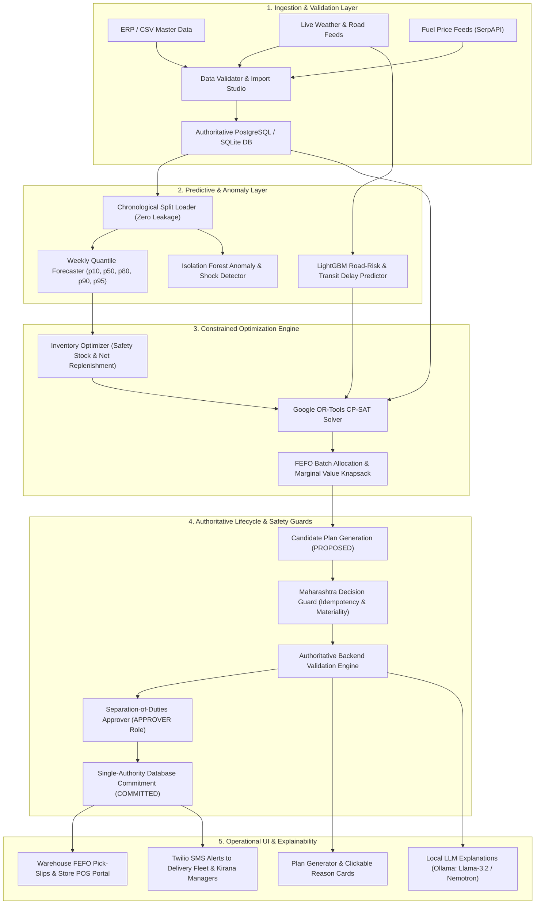
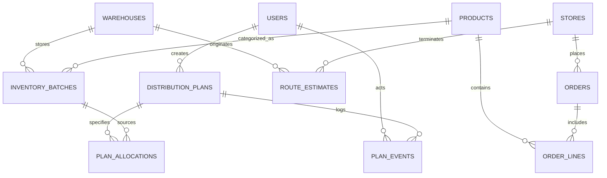
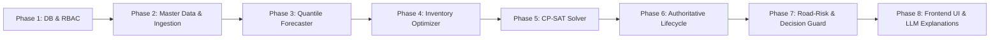

# HETVAYA / FlowGrid: System Architecture & Key Features Implementation Blueprint
**Problem Domain:** AI-Powered FMCG Distribution Intelligence, Expiry-Aware Inventory Optimization, and Constrained Dispatch  
**Reference Hackathon:** SGU Triwizathon (Problem Statement 2)  
**Authoritative Version:** 2.0 Production Ready

---

## 1. Executive Summary & Problem Domain

In Fast-Moving Consumer Goods (FMCG) distribution networks across India and emerging markets, supply chain managers encounter a chronic structural inefficiency:
- **Retail stockouts:** Kirana stores and urban mini-marts run out of high-velocity SKUs (edible oils, packaged foods, daily essentials).
- **Simultaneous warehouse overstock:** Usable inventory sits idle in nearby regional distribution centers.
- **Expiry losses:** Products expire on warehouse pallets or arrive with insufficient remaining shelf life for retail sale.
- **Freight churn & transit delays:** Unoptimized routing, monsoon road conditions (e.g., Western Ghats bottlenecks), and sudden fuel price spikes inflate logistical expenses.
- **Black-box decisions:** Store operators and depot managers distrust automated allocations because reasons are obscured.

**HETVAYA / FlowGrid** solves these five operational questions:
1. *Which products need replenishment immediately?*
2. *What exact quantity should each store receive?*
3. *Which store should be prioritized when warehouse stock is scarce?*
4. *Which warehouse and specific inventory batch should supply each store?*
5. *Why was that specific dispatch recommendation made?*

---

## 2. High-Level System Architecture

---

## 3. Core Architectural Principles (Non-Negotiable Invariants)

When porting this architecture to another project, enforce these five immutable design patterns:

### Invariant 1: The Single-Authority Principle
- **The Optimization/AI Service NEVER directly commits inventory.**
- The AI / Solver runs purely as a **Candidate Proposal Generator**.
- The Core Backend API acts as the **Sole Authority** to validate business constraints, lock database rows (`SELECT ... FOR UPDATE`), and commit final inventory balance decrements.
- If the solver produces an illegal state, the backend rejects it.

### Invariant 2: Separation of Duties (Four-Eyes Principle)
- A **PLANNER** creates scenarios and generates candidate proposals.
- An independent **APPROVER** (or Admin) must inspect and authorize the plan.
- The system programmatically blocks users from approving their own created plans (`created_by_user_id != approved_by_user_id`).

### Invariant 3: Zero-Data-Leakage Chronological Splits
- Time-series sales data must strictly enforce chronological boundaries:
  - Training window: $[T_0, T_{train}]$
  - Validation window: $[T_{train} + 1, T_{val}]$
  - Test holdout: $[T_{val} + 1, T_{test}]$
- Lag features (`lag_1`, `lag_7`, `lag_14`, `lag_28`) and rolling statistics (`rolling_mean_7`, `rolling_std_28`) must only be computed from rows preceding the forecast timestamp.

### Invariant 4: Soft-Slack Feasibility Guarantee
- Solvers must **never crash or return INFEASIBLE** in severe stockouts.
- Deficits are modeled using soft slack penalty variables with a steep shortage penalty ($₹150/\text{unit}$), allowing the engine to fulfill as much high-priority demand as possible without crashing.

### Invariant 5: Deterministic Fallback for Generative AI
- Generative LLM features (Ollama explanations, natural language disruption parsing) must wrap with strict timeouts ($30\text{--}45\text{s}$) and automatic deterministic rule-based fallbacks. The system must operate 100% reliably even if Ollama is offline.

---

## 4. The 10 Core Functional Modules & Implementation Details

### Module 1: Inventory Health & Multi-Echelon Visibility Dashboard
* **Purpose:** Monitor warehouse depot capacities and store-level Days of Supply (DOS).
* **Inventory Health Classifications:**
  - `CRITICAL_STOCKOUT_RISK`: $\text{DOS} < 2.0\text{ days}$ (Triggers $P_0$ Immediate dispatch).
  - `LOW_STOCK`: $2.0 \le \text{DOS} < 4.0\text{ days}$ (Triggers $P_1$ High priority).
  - `BALANCED`: $4.0 \le \text{DOS} \le 12.0\text{ days}$ (Healthy coverage).
  - `OVERSTOCKED_EXCESS`: $\text{DOS} > 12.0\text{ days}$ (Blocks inbound shipments).
* **Formulas:**
  $$\text{Days of Supply (DOS)}_{s,k} = \frac{\text{On Hand}_{s,k}}{\max(0.1, \text{Daily Forecast Demand}_{s,k})}$$

---

### Module 2: Calibrated Quantile Demand Forecasting
* **Purpose:** Multi-horizon store-SKU daily and weekly sales prediction.
* **Models Implemented:**
  1. **Baseline:** Seasonal Naive ($7$-day seasonal lag).
  2. **Tabular Gradient Boosting:** `HistGradientBoostingRegressor` / `LightGBM` predicting five quantiles ($p_{10}, p_{50}, p_{80}, p_{90}, p_{95}$) using Pinball / Quantile loss.
  3. **DeepDemandNet (PyTorch):** Entity embedding layers for Store ID ($d=16$) and SKU ID ($d=32$), concatenated with continuous features through a $3$-layer Residual MLP with Dropout ($0.2$) and BatchNorm.
* **Adoption Decision Gate:**
  A trained ML model is promoted over the baseline only when it clears the relative WAPE improvement threshold:
  $$\text{Relative WAPE Improvement} = \frac{\text{WAPE}_{\text{baseline}} - \text{WAPE}_{\text{model}}}{\text{WAPE}_{\text{baseline}}} \ge 0.05 \quad (5\%)$$
  $$\text{WAPE} = \frac{\sum_{i=1}^N |y_i - \hat{y}_i|}{\sum_{i=1}^N y_i}$$

---

### Module 3: Demand Anomaly & Shock Detection
* **Purpose:** Prevent the bullwhip effect caused by flash sales, promotional data spikes, or data collection errors.
* **Algorithm:** `IsolationForest(contamination=0.03, random_state=42)`.
* **Action:** Flagged demand spikes are automatically clamped to the $95^{\text{th}}$ percentile historical rolling cap before passing into replenishment calculations.

---

### Module 4: Dynamic Inventory Optimization
* **Purpose:** Transform unconstrained sales forecasts into net replenishment orders under lead-time uncertainty.
* **Mathematical Formulations:**
  - **Safety Stock ($SS$):**
    $$SS_{s,k} = Z_\alpha \cdot \sigma_{s,k} \cdot \sqrt{LT}$$
    Where $Z_\alpha = 1.65$ (for 95% service level), $\sigma_{s,k}$ is demand standard deviation, and $LT$ is lead time in days.
  - **Target Stock:**
    $$\text{Target}_{s,k} = \hat{D}_{s,k} + SS_{s,k}$$
  - **Net Replenishment Need:**
    $$\text{Replenishment}_{s,k} = \max\Big(0, \, \text{Target}_{s,k} - \text{OnHand}_{s,k} - \text{InTransit}_{s,k}\Big)$$

---

### Module 5: Constrained Allocation & Dispatch Optimizer (Google OR-Tools CP-SAT)
* **Purpose:** Solve multi-depot, multi-store, multi-SKU constrained allocation.
* **Decision Variables:**
  - $x_{w, s, k} \in \mathbb{Z}_{\ge 0}$: Quantity of SKU $k$ dispatched from Warehouse $w$ to Store $s$.
  - $\text{slack}_{s, k} \in \mathbb{Z}_{\ge 0}$: Unfulfilled shortage units for Store $s$, SKU $k$.
* **Objective Function (Minimize Total Cost & Penalties):**
  $$\min \sum_{w} \sum_{s} \sum_{k} \Big( C_{\text{trans}} \cdot \text{Dist}_{w,s} \cdot \text{Weight}_k \cdot x_{w,s,k} \Big) + \sum_{s} \sum_{k} \Big( P_{\text{shortage}} \cdot \text{slack}_{s,k} \Big) - \sum_{w} \sum_{s} \sum_{k} \Big( \text{PriorityWeight}_{s} \cdot x_{w,s,k} \Big)$$
* **Hard Constraints:**
  1. **Depot Capacity / Stock Availability:**
     $$\sum_{s} x_{w,s,k} \le \text{AvailableStock}_{w,k} \quad \forall w, k$$
  2. **Demand Fulfillment with Soft Slack:**
     $$\sum_{w} x_{w,s,k} + \text{slack}_{s,k} = \text{NetReplenishment}_{s,k} \quad \forall s, k$$
  3. **Vehicle Payload Weight Limit:**
     $$\sum_{k} \text{Weight}_k \cdot x_{w,s,k} \le \text{VehicleMaxWeight}_{w,s} \quad \forall w, s$$
  4. **Vehicle Payload Volume Limit:**
     $$\sum_{k} \text{Volume}_k \cdot x_{w,s,k} \le \text{VehicleMaxVolume}_{w,s} \quad \forall w, s$$
  5. **Store Backroom Capacity Limit:**
     $$\text{CurrentStoreCases}_s + \sum_{w} \sum_{k} \frac{x_{w,s,k}}{\text{CasePack}_k} \le \text{MaxBackroomCases}_s \quad \forall s$$

---

### Module 6: FEFO (First-Expired, First-Out) Shelf-Life Protection
* **Purpose:** Eradicate expiry wastage by intelligently matching batch expiration dates to retail turnover.
* **Rule Engine:**
  - **Arrival Shelf-Life Filter:**
    $$\text{Arrival Shelf Life Ratio} = \frac{\text{Expiry Date} - (\text{Dispatch Date} + \text{Transit Time})}{\text{Total Shelf Life Days}} \ge 0.70 \quad (70\%)$$
    Batches with $<70\%$ remaining shelf life upon store arrival are **strictly disqualified** from dispatch to slow-moving stores.
  - **Near-Expiry High-Velocity Routing:** Batches expiring within $30\text{--}60$ days are prioritized and routed exclusively to top-tier, high-turnover stores ($P_0$ stores) capable of selling out before expiration.

---

### Module 7: Maharashtra Road-Risk & Transit Delay Intelligence
* **Purpose:** Dynamic transit time prediction and route hazard alert system.
* **Trained Models:**
  - **LightGBM Regressor:** Predicts transit delay in minutes based on:
    - `rainfall_mm` (live IMD monsoon feeds)
    - `visibility_km`
    - `pothole_or_surface_risk_index` ($0.0\text{--}1.0$)
    - `waterlogging_flag` ($0$ or $1$)
    - `traffic_congestion_index`
    - `is_ghat_route` (Western Ghat corridors: Khandala, Kasara, Bhor ghats)
  - **Random Forest Classifier:** Classifies corridor hazard severity (`LOW`, `MEDIUM`, `HIGH`).
* **Dynamic Surcharge Formula:**
  $$\text{Adjusted Freight} = \text{Base Freight} \times \Big( 1.0 + \alpha_{\text{fuel}} \frac{\Delta \text{Diesel}}{\text{Base Diesel}} + \beta_{\text{delay}} \frac{\text{DelayMin}}{60} \Big)$$

---

### Module 8: Event-Driven Replanning & Decision Guardrails
* **Component:** `MaharashtraDecisionGuard`
* **Safeguards Against Route Churn:**
  1. **Idempotency Check:** Rejects duplicate webhook events using hash-based deduplication.
  2. **Stale Event Cutoff:** Events older than $60\text{ minutes}$ require manual review.
  3. **Materiality Threshold ($<2\%$):** Minor transit delay impacts costing $<2\%$ of total route margin do **not** trigger network replanning; they are logged as cost deltas to avoid driver confusion.
  4. **Driver Reassignment:** If a delivery agent's heartbeat is lost or vehicle breaks down, the guard unassigns pending dispatches and re-triggers solver allocation across available fleet.

---

### Module 9: Explainable AI & Local LLM Integration (Ollama)
* **Purpose:** Generate human-understandable audit rationales for distribution plans.
* **Reason Card Structure:**
  Every proposed shipment includes a synthesized reason card:
  - **Category:** `EXPIRY_URGENT`, `STOCKOUT_PREVENTION`, `PROMOTION_SURGE`, `DISTANCE_OPTIMAL`.
  - **Natural Language Rationale:** e.g., *"Store STORE-004 has 1.2 days of supply remaining for Fortune Sunflower Oil 1L. Warehouse WH-01 holds Batch LOT-2026-B8 expiring in 45 days. Dispatched via NH-48 corridor (₹4.20/case freight) meeting 78% arrival shelf-life criteria."*
* **Fallback Guarantee:** If Ollama daemon is unresponsive within $45\text{ seconds}$, a rule-based template engine automatically populates verified reason strings.

---

### Module 10: Retail Kirana POS & Master Data Import Studio
* **Kirana POS Portal:**
  - Mobile-responsive store manager view with shelf-life visual badges (Green: $>90$ days, Amber: $30\text{--}90$ days, Red: $<30$ days).
  - Offline-first sales logging backed by browser IndexedDB queue; automatically resynchronizes upon internet reconnection.
  - Multi-language localization: English, Hindi (`हिन्दी`), and Marathi (`मराठी`).
* **Import Studio:**
  - Drag-and-drop CSV validator for 6 core master datasets (`warehouses.csv`, `stores.csv`, `skus.csv`, `inventory_batches.csv`, `vehicles.csv`, `sales_history.csv`).
  - Pre-flight checks: missing headers, duplicate primary keys, negative prices, date format verification, and FK integrity.

---

## 5. Authoritative Database Schema (PostgreSQL / SQLite)

### Entity Relationship Diagram

### Table DDL Summary

| Table | Primary Key | Key Columns | Purpose |
| :--- | :--- | :--- | :--- |
| `users` | `id` (int) | `email`, `role`, `hashed_password`, `is_active` | RBAC: ADMIN, PLANNER, APPROVER, VIEWER, OPERATOR |
| `warehouses` | `id` (int) | `code` (WH-01), `name`, `latitude`, `longitude`, `capacity_cases` | Depot logistics and spatial positions |
| `stores` | `id` (int) | `code` (STORE-001), `store_type`, `backroom_capacity_cases`, `min_shelf_life_pct` | Retail endpoints with physical constraints |
| `products` | `id` (int) | `code` (SKU-001), `category`, `unit_weight_kg`, `unit_volume_l`, `shelf_life_days`, `mrp` | Product master data with dimensions & shelf life |
| `inventory_batches`| `id` (int) | `warehouse_id`, `product_id`, `lot_number`, `quantity`, `expiry_date`, `reserved_quantity` | Physical inventory batches for FEFO tracking |
| `route_estimates` | `id` (int) | `origin_warehouse_id`, `destination_store_id`, `corridor_code`, `distance_km`, `base_cost` | Distance matrix and corridor transit metrics |
| `delivery_agents` | `id` (int) | `agent_code`, `vehicle_type`, `capacity_kg`, `capacity_l`, `availability_status`, `lat`, `lng` | Real-time driver fleet tracking |
| `distribution_plans`| `id` (int) | `plan_code`, `scenario_id`, `status`, `created_by_user_id`, `approved_by_user_id`, `total_cost` | Plan lifecycle header |
| `plan_allocations` | `id` (int) | `plan_id`, `batch_id`, `source_wh_id`, `dest_store_id`, `sku_id`, `quantity`, `priority`, `reason` | Concrete dispatch instructions |
| `plan_events` | `id` (int) | `plan_id`, `event_type`, `actor_user_id`, `details_json`, `created_at` | Immutable append-only audit trail |
| `sales_observations`| `id` (int)| `store_id`, `product_id`, `observation_date`, `units_sold`, `closing_stock`, `is_promo` | Zero-leakage time-series sales records |

---

## 6. Core REST API Interface

### Authentication & Lifecycle Endpoints
- `POST /api/v1/auth/login` $\to$ Returns JWT bearer token with assigned user role.
- `GET /api/v1/plans/` $\to$ Query plans filtered by status (`DRAFT`, `GENERATED`, `VALIDATED`, `APPROVED`, `COMMITTED`).
- `POST /api/v1/plans/generate` $\to$ Initiates solver run for a given scenario snapshot; creates plan in `GENERATED` status.
- `POST /api/v1/plans/{id}/validate` $\to$ Executes backend constraint checking; transitions to `VALIDATED` or `REJECTED`.
- `POST /api/v1/plans/{id}/approve` $\to$ Approver role validates separation-of-duties; transitions to `APPROVED`.
- `POST /api/v1/plans/{id}/commit` $\to$ Atomically locks inventory rows, decrements batches, logs `PLAN_COMMITTED` event; transitions to `COMMITTED`.
- `GET /api/v1/plans/{id}/audit` $\to$ Returns complete, immutable chronological audit log of all events.

### AI & Prediction Endpoints
- `POST /api/v1/forecasts/run` $\to$ Executes multi-quantile forecaster for top SKUs across stores.
- `POST /api/v1/ai/road-risk` $\to$ Predicts transit delays (minutes) and road hazard ratings for given route corridors.
- `POST /api/v1/ai/explain-plan` $\to$ Ollama-powered natural language explanation of plan movements.
- `POST /api/v1/ai/parse-disruption` $\to$ Converts unstructured driver reports into structured disruption events.

---

## 7. Step-by-Step Implementation Guide for a New Project

To replicate this entire architecture in another project, follow this 8-phase implementation roadmap:

### Phase 1: Database Setup & RBAC Security
1. Initialize FastAPI application with SQLAlchemy 2.0 and Alembic.
2. Create `enums.py` defining `UserRole`, `PlanStatus`, `PlanEventType`, `OrderStatus`.
3. Implement `app/core/security.py` with password hashing (`bcrypt`), JWT tokens, and separation-of-duties verification.
4. Run migrations to create `users`, `warehouses`, `stores`, `products`, `inventory_batches`, `distribution_plans`, `plan_allocations`, `plan_events`.

### Phase 2: Master Data Ingestion & Chronological Splitting
1. Define Pydantic models for CSV payloads with strict data validation (non-negative quantities, valid ISO dates).
2. Build an ingestion loader that normalizes date fields and creates zero-leakage training splits.
3. Generate lag features (`lag_1`, `lag_7`, `lag_14`, `lag_28`) and rolling statistics strictly backwards in time.

### Phase 3: Demand Forecasting Engine
1. Implement `WeeklyQuantileForecaster` using `HistGradientBoostingRegressor` (or LightGBM) with `quantile` loss for $\alpha \in \{0.10, 0.50, 0.80, 0.90, 0.95\}$.
2. Implement Seasonal Naive baseline (7-day lag).
3. Implement the **5% relative WAPE gate**: only persist and deploy the ML model if it outperforms the baseline by $\ge 5\%$.
4. Integrate `IsolationForest` to detect and clamp demand outliers.

### Phase 4: Dynamic Inventory Health & Net Replenishment
1. Implement formulas for standard deviation of forecast error ($\sigma$) and safety stock ($SS = 1.65 \cdot \sigma \cdot \sqrt{LT}$).
2. Implement net replenishment calculation: $\max(0, \text{Target} - \text{OnHand} - \text{InTransit})$.
3. Implement Days of Supply (DOS) categorization: Critical, Low, Balanced, Overstocked.

### Phase 5: OR-Tools CP-SAT Dispatch Optimizer
1. Instantiate `ortools.sat.python.cp_model.CpModel`.
2. Add decision variables $x_{w,s,k}$ and soft slack variables $\text{slack}_{s,k}$.
3. Add warehouse stock capacity, vehicle weight (kg), vehicle volume (L), and store backroom capacity constraints.
4. Implement FEFO batch matching with the $70\%$ minimum arrival shelf-life filter.
5. Solve with a strict timeout ($6\text{--}8\text{ seconds}$) and export structured proposed movements.

### Phase 6: Authoritative Plan Lifecycle Service
1. Create `PlanLifecycleService` state machine:
   $$\text{DRAFT} \longrightarrow \text{GENERATED} \longrightarrow \text{VALIDATED} \longrightarrow \text{APPROVED} \longrightarrow \text{COMMITTED}$$
2. Implement backend validation: verify that proposed quantities do not exceed real-time inventory balances.
3. Implement `commit_plan`: wrap database updates in a database transaction (`with db.begin():`) with row-level locks on `inventory_batches`.
4. Log every state change to `plan_events` table for auditability.

### Phase 7: Road Risk Predictor & Decision Guard
1. Train a LightGBM regressor on route distance, rainfall, congestion, and ghat indicators to predict transit delay.
2. Implement `MaharashtraDecisionGuard` to filter real-time events, enforce deduplication, reject stale alerts ($>60\text{ min}$), and enforce the $<2\%$ materiality threshold.

### Phase 8: Frontend UI & Local LLM Explanations
1. Build React/TypeScript dashboard with Vite and Tailwind CSS.
2. Implement Views:
   - **PlanGeneratorView:** Filter scenarios, run solver, display proposed shipment cards with priority badges ($P_0, P_1, P_2$).
   - **ReasonCardModal:** Displays exact rationale, shelf-life stats, and route cost breakdown.
   - **AdminHealthView:** System uptime, database latency, separation-of-duties compliance.
   - **WarehouseOpsView & KiranaPOS:** FEFO pick-slips and store-level stock tracking.
3. Connect Ollama client (`llama3.2` or fallback) to generate natural language explanations for operators.

---

## 8. Technology Stack Reference

| Layer | Recommended Technology | Current Project Component |
| :--- | :--- | :--- |
| **Backend Framework** | FastAPI (Python 3.11+) | `app/main.py`, `app/api/v1/` |
| **ORM & Database** | SQLAlchemy 2.0 + PostgreSQL (SQLite for local dev) | `app/db/`, `app/models/` |
| **DB Migrations** | Alembic | `alembic/` |
| **Data Validation** | Pydantic v2 & Pydantic-Settings | `app/schemas/` |
| **Mathematical Solver** | Google OR-Tools CP-SAT | `models/stock_optimizer.py` |
| **Forecasting & ML** | Scikit-learn, LightGBM, PyTorch | `models/weekly_quantile_forecaster.py`, `models/neural_demand_forecaster.py` |
| **Transit Risk ML** | LightGBM Regressor + Random Forest Classifier | `models/road_risk_predictor.py` |
| **Local LLM API** | Ollama (`llama3.2:latest`, `nemotron-3-ultra`) | `app/services/ollama_service.py`, `models/ollama_intelligence.py` |
| **Frontend Framework** | React 19 + TypeScript | `src/App.tsx`, `src/components/` |
| **Styling & Components**| Tailwind CSS v4, Lucide React, Shadcn/Radix UI | `src/index.css`, `components.json` |
| **Charts & Geospatial** | Recharts, MapLibre GL | `src/components/map-section/DataMap.tsx` |
| **Build & Bundling** | Vite 6 / 8 | `vite.config.ts`, `package.json` |
| **Notifications** | Twilio SMS API | `app/services/twilio_service.py` |
| **External Feeds** | SerpAPI (Diesel Fuel Index) | `app/services/fuel_service.py` |

---

## 9. Benchmark Verification & Evaluation Standards

When evaluating the system in another project, verify against these acceptance metrics:
1. **Zero Data Leakage:** Ensure training and testing splits have zero temporal overlap.
2. **5% WAPE Gate:** ML models must exceed Seasonal Naive baseline by at least $5\%$ relative WAPE.
3. **Zero Hard Constraint Violations:** Solvers must strictly respect warehouse stock limits, vehicle weights, and store storage.
4. **Feasibility:** In extreme stockout simulations, solver must achieve $100\%$ feasible solve rate via soft slack penalties.
5. **Solve Latency:** Average solver execution time should remain under $1.0\text{ second}$ ($p_{50} \approx 0.5\text{ ms}$, $p_{95} \approx 0.9\text{ ms}$ for typical regional sub-networks).
6. **Auditability:** $100\%$ of plan transitions must be tracked in immutable event logs with timestamps and actor IDs.
